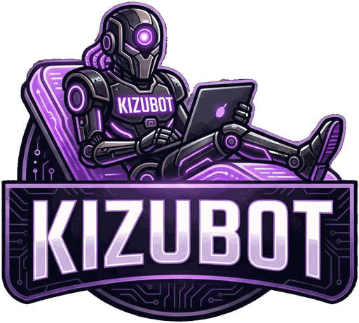

<div align="center">

<a href="https://www.kizubot.com">
  
</a>

# KizuBot: bot para PokeXGames (PXG) na nuvem

Bot para PokeXGames que roda nos servidores do KizuBot, com o seu PC desligado.
Cavebot, combate, cura, captura de shiny, farming, pesca e alarmes no WhatsApp,
tudo configurado por um painel web.

**[Site oficial: www.kizubot.com](https://www.kizubot.com)** ·
[Criar conta](https://painel.kizubot.com/register) ·
[Documentação](https://www.kizubot.com/docs) ·
[Vídeos](https://www.kizubot.com/videos) ·
[Changelog](https://www.kizubot.com/changelog) ·
[English](#english)

</div>

---

## O que é o KizuBot

O KizuBot é um bot de automação para o PokeXGames (PXG). Em vez de rodar no seu
computador, ele roda em máquinas nos servidores do KizuBot. Você configura tudo
pelo painel web, deixa o personagem caçando e acompanha pelo navegador ou pelo
celular. Seu PC pode ficar desligado.

Este repositório é o código do site [www.kizubot.com](https://www.kizubot.com):
a página de apresentação, a documentação, o changelog e a galeria de vídeos. O
bot em si e o painel não estão aqui.

## O que ele faz

Cada módulo tem um guia próprio na [documentação](https://www.kizubot.com/docs).

| Módulo | O que automatiza |
| --- | --- |
| [Cavebot](https://www.kizubot.com/docs/cavebot) | Rotas e waypoints gravados com o Recorder, para caçar sem ficar no teclado |
| [Combate](https://www.kizubot.com/docs/combat) | Ataques, combos, loot, atacar todos os pokémons na tela, ignorar loot e captura quando há outros jogadores |
| [Cura](https://www.kizubot.com/docs/healing) | Revive, poções, berries e troca inteligente de pokémon |
| [Captura](https://www.kizubot.com/docs/catch) | Escolha de pokébolas e captura automática, com reconhecimento de shiny, mega e boss |
| [Farming](https://www.kizubot.com/docs/farming) | Coleta de recursos e headbutt |
| [Pesca](https://www.kizubot.com/docs/fishing) | Pesca automática |
| [Alarmes](https://www.kizubot.com/docs/alarms) | Avisos no WhatsApp quando aparece shiny, boss, mega, jogador ou GM, entre outros eventos |
| [Party](https://www.kizubot.com/docs/party) | Atividades em grupo |
| [Setup de Pokémon](https://www.kizubot.com/docs/setup) | Skills e estratégia configuradas pokémon por pokémon |
| [Actions e Rules](https://www.kizubot.com/docs/actions) | Regras próprias com condições e ações |
| [Humanização](https://www.kizubot.com/docs/humanization) | Variação nos tempos e nas pausas para o comportamento ficar menos repetitivo |
| [Estatísticas](https://www.kizubot.com/docs/statistics) | Relatórios de sessão, loot e coleta |
| [KizuAI](https://www.kizubot.com/docs/kizu-ai) | Assistente dentro do painel |

Outros pontos que o site destaca:

- funciona com o PC desligado e dá para controlar pelo celular
- resposta automática a GMs configurável no painel
- changelog público com cada atualização datada, desde outubro de 2024

## Como começar

1. Crie sua conta em [painel.kizubot.com/register](https://painel.kizubot.com/register).
2. Escolha um plano na [seção de preços](https://www.kizubot.com/#pricing). O plano
   Base de 7 dias serve para testar antes de pacotes maiores. Os valores mudam,
   por isso ficam só no site.
3. Siga o guia [Machine Setup](https://www.kizubot.com/docs/machine-setup) para
   preparar a máquina e abrir a sessão.
4. Conheça o painel em [GridView](https://www.kizubot.com/docs/gridview) e
   configure os módulos, começando por [Setup de Pokémon](https://www.kizubot.com/docs/setup)
   e [Cavebot](https://www.kizubot.com/docs/cavebot).
5. Configure os [alarmes](https://www.kizubot.com/docs/alarms) antes de deixar o
   personagem sozinho.

Dúvidas de compra e suporte: WhatsApp pelo link no rodapé do site.

## Vídeos

Hunts, projetos shiny, pesca e farming gravados com o KizuBot, todos no canal
[@kizubotpxg](https://www.youtube.com/@kizubotpxg) e com página própria no site:

- [Hunt de Meganium em Outland North](https://www.kizubot.com/videos/uJ4P_n-E33I)
- Projetos shiny de Feraligatr e Venusaur em Kanto
- Hunt de Medicham em Phenac e de Sandslash em Outland South
- Pesca em level baixo em Kanto
- Farm de 2 horas com captura de shiny, madeira, headbutt e pontos de stylist
- Novo sistema de alarmes

Lista completa: [kizubot.com/videos](https://www.kizubot.com/videos).

## Perguntas frequentes

**Preciso deixar o PC ligado?**
Não. O bot roda nos servidores do KizuBot. Você acompanha pelo navegador ou pelo
celular.

**Existe bot de PXG grátis?**
O KizuBot não tem plano gratuito. O menor pacote é o Base de 7 dias, pensado para
testar. Veja os valores atuais em [kizubot.com/#pricing](https://www.kizubot.com/#pricing).

**Tem acesso vitalício?**
Não. O serviço tem custos mensais de servidor, atualizações, alarmes e IA.

**Qual a diferença entre Base e Premium?**
Base conta dias corridos e permite alternar 3 personagens em sequência na mesma
máquina, 8 horas cada, um por vez. Premium consome saldo de horas só enquanto o
personagem está online, não expira, libera voo, montaria e coleta de recursos do
Nightmare World e usa uma máquina com mais recursos. Não há upgrade de um para o
outro: Premium é licença nova.

**O bot funciona 24 horas?**
O plano Base permite até 24 horas por dia na mesma máquina, alternando até 3
personagens, um de cada vez. No Premium o saldo conta apenas as horas online.

**É seguro? Posso ser banido?**
Nenhum bot é 100% seguro. A PXG proíbe bots e macros, e os banimentos são feitos
manualmente por GMs. Leia as [dicas de segurança](https://www.kizubot.com/tips)
antes de começar e use os alarmes.

**Como funcionam os alarmes?**
Você escolhe quais eventos geram aviso no WhatsApp: jogador na tela, shiny, boss,
mega, mensagem privada, vida baixa e outros.

**O KizuBot ainda é atualizado?**
Sim. Cada atualização entra no [changelog](https://www.kizubot.com/changelog) com
data, e você pode assinar o [feed RSS](https://www.kizubot.com/feed.xml).

**Quais formas de pagamento?**
Cartão e boleto no [checkout do painel](https://painel.kizubot.com/checkout), com
liberação automática. PIX e criptomoedas são confirmados manualmente pelo
WhatsApp.

Mais respostas: [KizuBot vs outros bots de PXG](https://www.kizubot.com/comparativo).

## Páginas do site

| Página | Endereço |
| --- | --- |
| Início | [kizubot.com](https://www.kizubot.com) |
| Documentação (18 guias) | [kizubot.com/docs](https://www.kizubot.com/docs) |
| Comparativo com outros bots | [kizubot.com/comparativo](https://www.kizubot.com/comparativo) |
| Dicas de segurança | [kizubot.com/tips](https://www.kizubot.com/tips) |
| Vídeos | [kizubot.com/videos](https://www.kizubot.com/videos) |
| Changelog | [kizubot.com/changelog](https://www.kizubot.com/changelog) |
| Feed RSS | [kizubot.com/feed.xml](https://www.kizubot.com/feed.xml) |
| Privacidade, termos, reembolsos | [kizubot.com/privacy-policy](https://www.kizubot.com/privacy-policy) · [terms-of-service](https://www.kizubot.com/terms-of-service) · [refunds](https://www.kizubot.com/refunds) |

---

## English

KizuBot is a cloud-based automation bot for PokeXGames (PXG). It runs on KizuBot
servers, so your PC can stay off, and you control it from a web panel on desktop
or phone.

**Site:** [www.kizubot.com/en](https://www.kizubot.com/en) ·
**Sign up:** [painel.kizubot.com/register](https://painel.kizubot.com/register) ·
**Videos:** [www.kizubot.com/en/videos](https://www.kizubot.com/en/videos) ·
**Changelog:** [www.kizubot.com/en/changelog](https://www.kizubot.com/en/changelog)

What it automates: cavebot routes, combat, healing and revive, catching with
shiny/mega/boss recognition, resource farming, fishing, party play, custom
action rules, and WhatsApp alarms. Each module is covered in the
[documentation](https://www.kizubot.com/docs), which is currently in Portuguese.

Getting started:

1. Create an account at [painel.kizubot.com/register](https://painel.kizubot.com/register).
2. Pick a plan on the [pricing section](https://www.kizubot.com/en#pricing). The
   7-day Base plan is the cheapest way to try it. There is no free plan and no
   lifetime license.
3. Follow the [Machine Setup guide](https://www.kizubot.com/docs/machine-setup),
   then configure the modules in the panel.

Please read the [safety tips](https://www.kizubot.com/tips) first: no bot is
100% safe, PXG forbids bots and macros, and bans are issued manually by GMs.

---

## About this repository

Next.js source of the KizuBot marketing site: landing page, documentation,
changelog, video pages, feeds and SEO. The bot, the dashboard and the backend
live in other, private projects.

- Stack: Next.js 15 (App Router), React 19, Tailwind CSS, Radix UI, Framer Motion
- Content: Portuguese pages plus an English home, videos and changelog
- Changelog entries are MDX files in `content/changelog`
- Reviewed video metadata lives in `content/videos`
- Pages are in `app/`, components in `components/`, SEO helpers in `lib/seo.ts`
- Plan prices are loaded at runtime from the dashboard catalog (`lib/pricing.ts`)

Run it locally:

```sh
pnpm install
pnpm dev
pnpm test:seo
```

Issues about the site (typos, broken links, SEO) are welcome. For bot support,
use the WhatsApp link on [www.kizubot.com](https://www.kizubot.com).

KizuBot is an independent project and is not affiliated with the developers of
PokeXGames.
